# eDoktor

Full-stack project for the Razvoj Softvera 2 course @ FIT. **Index number: IB210059.**
The SQL Server database is named **`210059`** (index number without the `IB` prefix, per the assignment).
**eDoktor** is an e-Health platform that connects patients with doctors digitally: search doctors by specialization, book appointments, do online video consultations, view your medical record + e-prescriptions, and pay via PayPal.

It uses a microservice-style architecture (REST API + Worker), .NET 8 / SQL Server / RabbitMQ / Redis, a Flutter desktop app for administrators, and a Flutter mobile app for patients.

## Table of Contents
- [Project Overview](#project-overview)
- [Tech Stack](#tech-stack)
- [Screenshots](#screenshots)
- [Features](#features)
- [Getting Started](#getting-started)
- [Credentials](#credentials)
- [Configuration (.env)](#configuration-env)
- [PayPal Sandbox](#paypal-sandbox)
- [Doctor Recommendation System](#doctor-recommendation-system)
- [Messaging (RabbitMQ)](#messaging-rabbitmq)
- [Real-time notifications (SignalR)](#real-time-notifications-signalr)
- [Appointment State Machine](#appointment-state-machine)

## Project Overview
- Patients register/login on the **mobile app**, search doctors by specialization or name, book appointments from a calendar of available slots (in-person or online), pay with PayPal, attend video consultations, view their **electronic medical record** (visits, prescriptions, lab results), and receive real-time notifications.
- Administrators use the **desktop app** to manage doctors, specializations, clinics, cities, patients, appointments and payments, and to view reports.
- Doctors are managed accounts created by the admin (the temporary password is emailed to them). There is no separate doctor app: doctors use the API (Swagger) to confirm/complete appointments, add medical-record entries, issue prescriptions and chat during online consultations; the admin can do the appointment actions from the desktop app.

## Tech Stack
- **Backend**: .NET 8 (`eDoktor.API`), Entity Framework Core, SQL Server 2022
- **Worker**: .NET 8 (`eDoktor.Worker`) — consumes RabbitMQ queues, sends emails (MailKit)
- **Messaging**: RabbitMQ 3.13
- **Cache**: Redis 7 (used by the recommender for cached doctor rankings)
- **Auth**: JWT bearer tokens, BCrypt password hashing
- **Real-time**: SignalR (push notifications to mobile clients)
- **Payments**: PayPal Checkout REST API (Sandbox)
- **Video calls**: Jitsi rooms on the public server `meet.ffmuc.net` (no sign-in needed; configurable via `VideoCall__BaseUrl`), the API mints a room id per online appointment
- **Recommender**: in-process TF-IDF + cosine similarity, weighted by rating / distance / availability (see [below](#doctor-recommendation-system))
- **Desktop app**: Flutter (Windows / macOS / Linux)
- **Mobile app**: Flutter (Android primarily)

## Screenshots

### Mobile app (patient)
<table>
  <tr>
    <td align="center">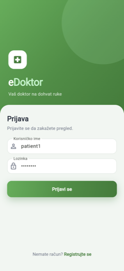<br>Prijava</td>
    <td align="center">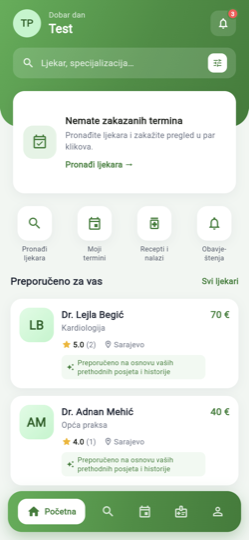<br>Početna i preporuke</td>
    <td align="center">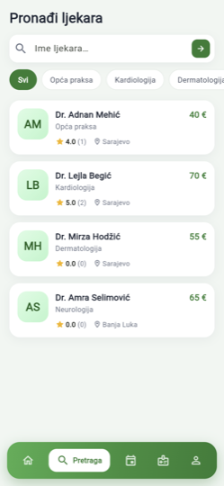<br>Pretraga ljekara</td>
    <td align="center">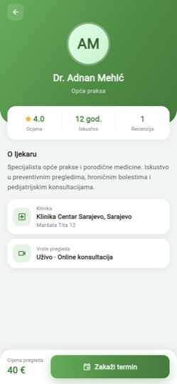<br>Profil ljekara</td>
  </tr>
  <tr>
    <td align="center">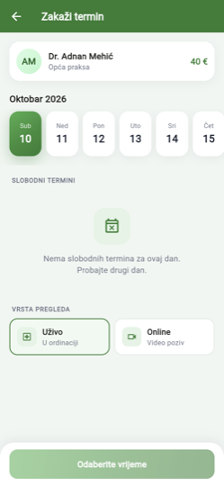<br>Zakazivanje termina</td>
    <td align="center">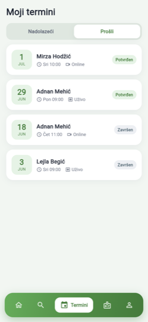<br>Moji termini</td>
    <td align="center">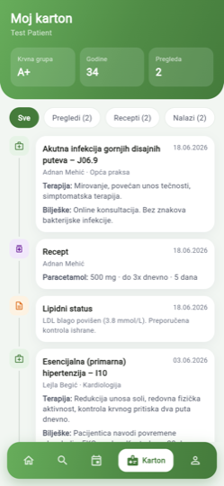<br>Zdravstveni karton</td>
    <td align="center">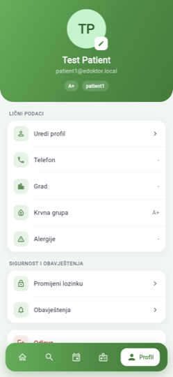<br>Profil</td>
  </tr>
</table>

### Desktop app (administrator)
<table>
  <tr>
    <td align="center">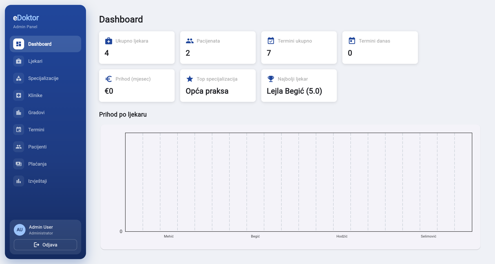<br>Dashboard</td>
    <td align="center">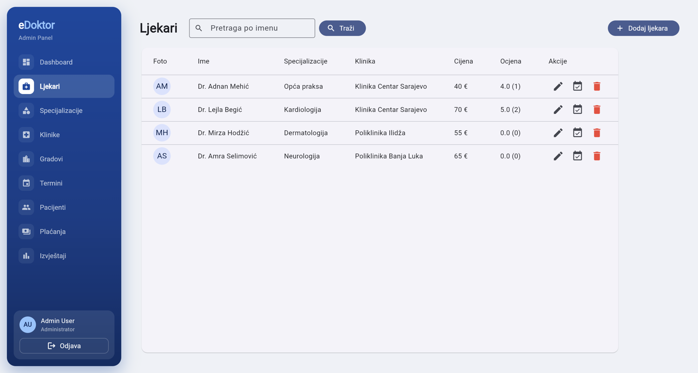<br>Ljekari</td>
  </tr>
  <tr>
    <td align="center">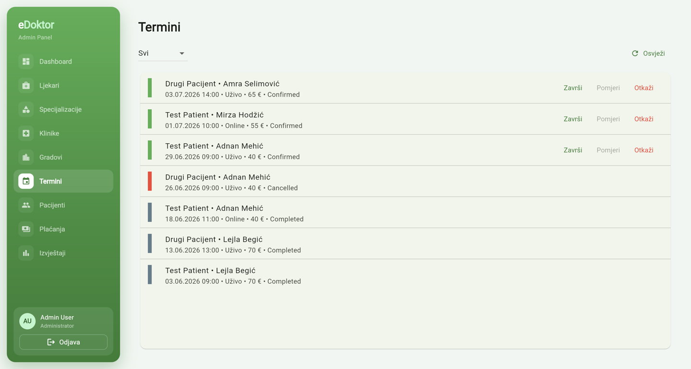<br>Termini</td>
    <td align="center">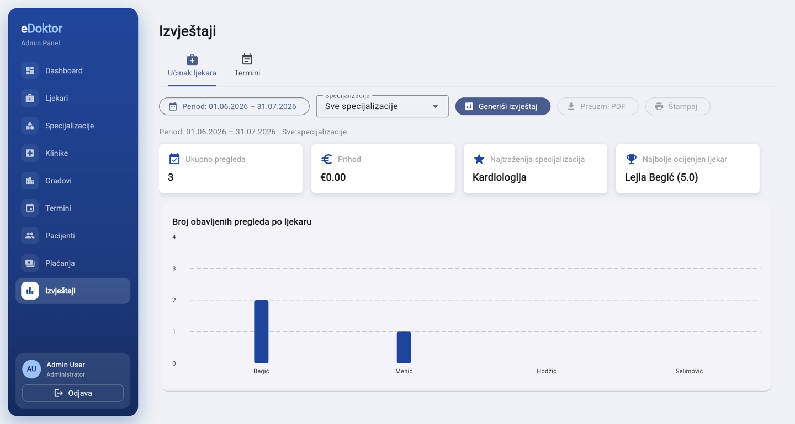<br>Izvještaji</td>
  </tr>
</table>

## Features

### Desktop app (administrator)
- **Dashboard** with key numbers (doctors, patients, appointments, monthly revenue, top specialization and doctor) and revenue per doctor.
- **Doctors**: CRUD with photo upload, phone, required email, specializations, clinic, price; per-doctor **working hours** that generate bookable time slots.
- **Specializations, clinics, cities**: CRUD. A clinic's location is picked on an OpenStreetMap map or found from its address (geocoding through the API).
- **Patients**: list and search; **patient details** with the full medical record (visits, prescriptions, lab results) and appointment history.
- **Appointments**: filter by status, confirm, complete, **reschedule** to another free slot (with a reason), cancel (reason required, the patient is notified), refund. Each appointment has an **audit trail** (who created/confirmed/moved/completed/cancelled it, when and why).
- **Payments**: all PayPal payments with filters, totals per status, manual refund.
- **Reports**: doctor performance (period + specialization) and appointments (period + status); chart + table; download or print as PDF.

### Mobile app (patient)
- Registration, login, **password reset** with a code sent by email, change password, edit profile.
- **Home** with personalized doctor recommendations and the reason for each one.
- **Doctor search** by name and specialization, with filters (city, maximum price, minimum rating, free in the next 7 days).
- **Doctor profile** with photo, bio, reviews; **booking from a calendar** (free / taken / selected days), in person or online.
- **PayPal** payment in a WebView; **payment history**.
- **Video consultation** (Jitsi) with an in-call **chat** that supports sending photos (camera/gallery, permissions requested at runtime).
- **Medical record** (master–details): visits, prescriptions, lab results; **prescriptions and results as PDF**.
- **Reviews** for completed appointments.
- **Notifications** in real time (SignalR) and by email: booking, confirmation, cancellation, rescheduling, payment, new prescription, **reminders 24h and 1h** before the appointment.

## Project Structure

```
eDoktor/
  eDoktor.API/             ASP.NET Core REST API (Swagger at /swagger)
  eDoktor.Model/           DTOs (Requests, Responses, SearchObjects, Messages)
  eDoktor.Services/        Domain services, EF Core context, recommender, state machine,
                           JWT, BCrypt, Redis cache, PayPal client, SignalR hub
  eDoktor.Worker/          RabbitMQ consumer (emails, etc.)
  Dockerfile               Builds the API image (the Worker has its own Dockerfile in eDoktor.Worker/)
  docker-compose.yml       SQL Server, RabbitMQ, Redis, API, Worker
  .env-tajne.zip           The real .env (password: fit)
  .env.example             All configuration keys, without secrets
UI/
  edoktor_desktop/         Flutter admin app
  edoktor_mobile/          Flutter patient app
```

## Getting Started

### Prerequisites
- Docker + Docker Compose
- Flutter 3.7+ (for running the desktop & mobile apps locally)
- .NET 8 SDK (only if you want to run the backend without Docker)

### Backend
```bash
cd eDoktor
unzip -P fit .env-tajne.zip   # creates eDoktor/.env (PayPal sandbox and SMTP already filled in)
docker compose up --build
```

This starts SQL Server, RabbitMQ, Redis, the API (port **5190**), and the Worker. On first boot the API creates the database `210059` and seeds it: one admin, two patients, four doctors with photos, specializations, clinics, cities, free time slots for the coming days, appointments in every state, payments, reviews, medical records, prescriptions and lab results.

To start again from an empty database: `docker compose down -v && docker compose up --build`.

- Swagger UI: <http://localhost:5190/swagger>
- RabbitMQ admin: <http://localhost:15672> (guest / guest)

> Emails are sent through SMTP with the credentials from `.env`. If `_fromAddress` / `_password` are left empty (e.g. when starting from `.env.example`), the Worker writes the emails to its log instead of sending them.

### Desktop app
```bash
cd UI/edoktor_desktop
flutter pub get
flutter run -d windows --dart-define=API_BASE_URL=http://localhost:5190   # or macos / linux
```
The ready-made Windows build is in the GitHub Release (`fit-build-*.zip` → `Release/edoktor_desktop.exe`). Without `--dart-define` the app uses `http://localhost:5190`.

### Mobile app (Android emulator)
```bash
cd UI/edoktor_mobile
flutter pub get
flutter run --dart-define=API_BASE_URL=http://10.0.2.2:5190
```
`10.0.2.2` is the Android emulator's alias for the host machine (also the default when no `--dart-define` is given).
The ready-made APK is in the GitHub Release (`fit-build-*.zip` → `app-release.apk`): uninstall any old version from the emulator, then drag the APK onto it.

Online consultations (Jitsi) and clinic maps (OpenStreetMap) need internet access on the device/emulator.

## Credentials
All seeded accounts use password **`stringst`**.

| Context | Username | Password |
|---|---|---|
| Desktop app (admin) | `admin` | `stringst` |
| Mobile app (patient, Sarajevo) | `patient1` | `stringst` |
| Mobile app (patient, Banja Luka) | `patient2` | `stringst` |
| Doctor (API / Swagger) | `doktor.mehic` (Opća praksa) | `stringst` |
| Doctor (API / Swagger) | `doktor.begic` (Kardiologija) | `stringst` |
| Doctor (API / Swagger) | `doktor.hodzic` (Dermatologija) | `stringst` |
| Doctor (API / Swagger) | `doktor.selimovic` (Neurologija) | `stringst` |
| PayPal sandbox buyer (in the payment WebView) | `TODO-sandbox-buyer@personal.example.com` | `TODO` |

## Configuration (.env)
Everything is configured through `eDoktor/.env` (read by `docker-compose.yml`); nothing is hard-coded or kept in `appsettings`. `.env.example` lists every key:

| Keys | Purpose |
|---|---|
| `_saPassword`, `_source`, `_catalog`, `_sqlPort` | SQL Server (database `210059`) |
| `_rabbitMqHost`, `_rabbitMqUser`, `_rabbitMqPassword`, `_rabbitMqPort` | RabbitMQ |
| `Redis__ConnectionString` | Redis cache for recommendations |
| `_fromAddress`, `_password`, `_host`, `_port`, `_enableSSL`, `_displayName`, `_timeout` | SMTP for the Worker |
| `Jwt__Issuer`, `Jwt__Audience`, `Jwt__Key`, `Jwt__ExpiryMinutes` | JWT tokens |
| `PayPal__ClientId`, `PayPal__ClientSecret`, `PayPal__BaseUrl`, `PayPal__Currency`, `PayPal__WebhookId`, `PayPal__ReturnUrl`, `PayPal__CancelUrl` | PayPal sandbox |
| `Cors__AllowedOrigins` | Browser origins allowed to call the API |
| `Swagger__Enabled` | Turns the Swagger UI on/off |
| `App__TimeZone` | Time zone for times in notifications and emails (data is stored in UTC) |
| `VideoCall__BaseUrl` | Jitsi server for online consultations |
| `Geocoding__BaseUrl` | OpenStreetMap Nominatim, for clinic address → coordinates |

The Flutter apps get the API address only through `--dart-define=API_BASE_URL=...`.

## PayPal Sandbox
Get a Sandbox client id/secret at <https://developer.paypal.com>. Fill in the env vars:

```
PayPal__ClientId=...
PayPal__ClientSecret=...
PayPal__BaseUrl=https://api-m.sandbox.paypal.com
```

The mobile app opens the PayPal approval flow in a `WebView` and watches for the redirect to `PayPal__ReturnUrl` / `PayPal__CancelUrl`. After approval, the app calls `/api/payments/paypal/orders/{orderId}/capture`; the API checks with PayPal that the order is `COMPLETED` for the right amount, marks the appointment as **Confirmed** and publishes a `payment.captured` RabbitMQ message. If the patient leaves the PayPal page, the unfinished order is cancelled and the patient can pay again.

Refunds: cancelling a paid appointment ≥24h before the start refunds it automatically; the admin can also refund from the **Payments** or **Appointments** screen.

Payment is finalized **server-side**: the capture endpoint verifies the order with PayPal, and the `paypal/webhook` endpoint verifies PayPal's signature (using `PayPal__WebhookId`) before acting. To test the full payment flow, configure real PayPal Sandbox credentials in `.env`.

## Doctor Recommendation System
Full documentation: [recommender-dokumentacija.md](recommender-dokumentacija.md).

The recommender lives at `eDoktor.Services/Recommender/RecommenderService.cs` and produces personalized doctor rankings using **content-based filtering**.

Formula:
```
score(d) = 0.50 · sim(p,d) + 0.25 · norm(rating(d)) + 0.15 · distDecay(d) + 0.10 · availability(d)
```

- **sim(p,d)** — cosine similarity between the patient's TF-IDF profile vector and the doctor's TF-IDF feature vector. The doctor's vector is built from specialization, sub-keywords from bio, and clinic city. The patient's vector is built from specializations of past appointments (doctors the patient rated 4–5 count double, doctors rated 1–2 are left out), diagnosis / therapy / notes in their medical record, and their last 20 doctor searches (typed text + chosen specialization, stored in `SearchHistories`).
- **norm(rating(d))** — average review rating, scaled to `[0, 1]` by dividing by 5.
- **distDecay(d)** — `exp(-distance_km / 25)` between the patient's stored coordinates and the clinic's coordinates. Falls back to `1.0` when locations are unknown.
- **availability(d)** — `1` if the doctor has any free time slot in the next 7 days, else `0`.

Each recommendation carries a short reason ("Visoko ocijenjen ljekar", "Ljekar u vašoj blizini", "Dostupan u narednih 7 dana", …) derived from the dominant scoring component.

The full ranked list is cached in **Redis** under `recs:{patientId}` for 6 hours. The cache is invalidated when the patient books an appointment, an appointment is completed, the patient submits a review, or makes a new search (so the next run reflects the new data). Cold-start (no review history) is handled automatically: with an empty patient vector, the similarity term collapses to 0 and the ranking falls back to rating + availability + distance.

## Messaging (RabbitMQ)
The Worker (`eDoktor.Worker`) consumes:

| Queue | Trigger | Effect |
|---|---|---|
| `email` | Appointment rescheduled, password-reset code | Sends the email |
| `appointment.booked` | Patient books an appointment | Sends a confirmation email |
| `appointment.cancelled` | Appointment cancelled | Sends a cancellation email; mentions the refund when one was made (the API refunds through PayPal before publishing) |
| `appointment.reminder` | `AppointmentReminderService` in the API (checks every minute) finds an appointment 24h or 1h away | Sends a reminder email |
| `payment.captured` | PayPal capture succeeded | Sends a receipt; appointment is also marked `Confirmed` |
| `prescription.issued` | Doctor issues an e-prescription | Notifies the patient |
| `doctor.created` | Admin creates a doctor account | Emails the doctor their temporary password |

Queues are durable and messages persistent, so queued emails survive a broker restart. The Worker acknowledges a message only after it was handled; failed messages are retried with backoff.

## Real-time notifications (SignalR)
The API exposes a hub at `/hubs/notifications` (JWT-authenticated; the mobile app passes the token via `?access_token=...`). The `NotificationService` writes a row to the `Notifications` table **and** pushes the event to the user's `user-{id}` SignalR group. The mobile app's `NotificationProvider` subscribes via `signalr_netcore` and refreshes the bell badge in real time.

## Appointment State Machine
Implemented in `eDoktor.Services/AppointmentStateMachine/`. States are stored as strings on the `Appointment.StateMachine` column. Transitions are centralized and validated server-side.

```
   create
  ┌──────►  Pending  ─── PayPal capture / admin or doctor confirms ──►  Confirmed  ─── doctor/admin marks done ──►  Completed
  │            │                                  │
  │            └── cancel (server unbooks slot, no refund)
  │                                               │
  │                                               └── cancel (≥24h before start + paid -> API refunds via PayPal; <24h -> no refund)
  │                                                                                 ↓
  └────────────────────────────────────────────────────────────────────────────► Cancelled
```

**Rescheduling** (admin, `Pending` or `Confirmed`, before the start): the appointment moves to another free slot of the same doctor, the old slot is freed, and the patient is notified with the reason.

Every transition runs in a transaction and records who did it and when (`ConfirmedAt/By`, `CompletedAt/By`, `CancelledAt/By` + reason, `RescheduledAt/By` + reason). The desktop app shows this as the appointment's history. Staff must give a reason when cancelling. Patients can act only on their own appointments, doctors only on theirs.

A review can only be created against an appointment in `Completed` state, enforced in `ReviewService`.

## Differences vs. eProdaja
- **Services, not products**: appointments and consultations, not items in a cart.
- **Video consultations** (Jitsi rooms minted per online appointment).
- **Electronic medical record**: visits / prescriptions / lab results, master–details UX on mobile.
- **E-prescriptions** with line items (medication, dosage, frequency, duration).
- **Calendar-based booking** with per-doctor time slots, not stock and cart.
- **TF-IDF + cosine recommender** with the weighted scoring formula above, instead of category-based product suggestions.
- **PayPal** for online payment, with admin-initiated refunds for cancellations.
- **Real-time SignalR notifications** for appointment events, prescriptions, payments.
